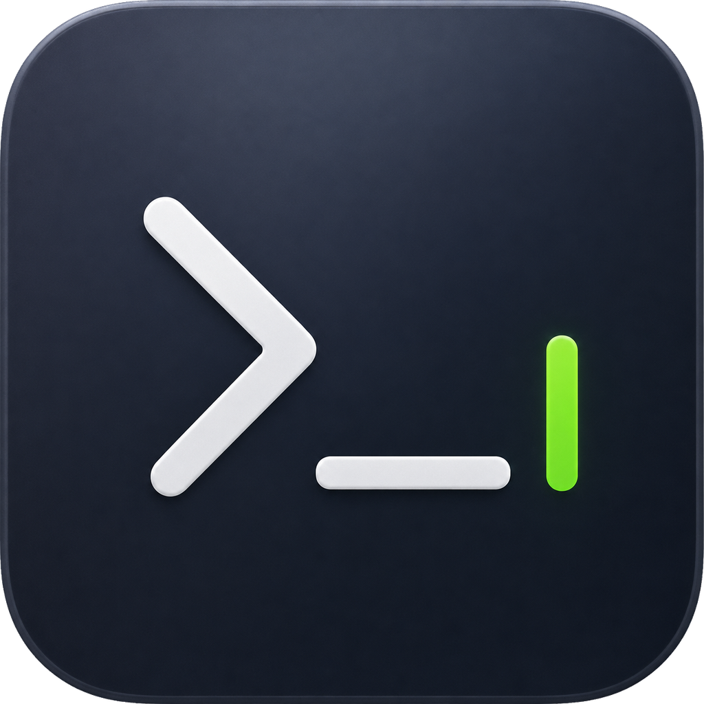

<p align="center">
  
</p>

<h1 align="center">GenieTerm</h1>

<p align="center">The terminal for people who live in SSH.</p>

GenieTerm is a macOS terminal built around four things that usually live in separate tools:

- **Command blocks.** GenieTerm follows your shell's prompts, so every command keeps its status, duration and output together. Copy a command or its output, re-run it, or jump between commands with ⇧⌘↑ / ⇧⌘↓. Underneath it is an ordinary xterm session; switch to the classic grid in Settings whenever you like.
- **Durable SSH.** A durable session keeps running on the host through sleep, network changes and app restarts, then reattaches and streams back whatever it printed while you were away.
- **Remote files.** Browse folders on this Mac or any connected host, preview Markdown, images and code, edit with atomic saves, drag files in, and download whole folders, all next to the shell that's using them.
- **Host.** See what a machine is doing: CPU, memory, every NVIDIA GPU and the processes holding it, the process list, and the ports its servers listen on. On an SSH host, Forward & open puts Jupyter, TensorBoard or a dev server on `localhost` in one click.

Long commands notify you when they finish while you're looking elsewhere, and every terminal header shows the folder and git branch it's in.

It runs on your machine. There is no account and no usage data. The one AI feature is optional: press ⇧⌘Space (Shift+Alt+Space on Linux), describe what you want, and GenieTerm proposes a command for you to review. It never runs one on its own.

## Install

Download the latest release from the [Releases page](https://github.com/Ry3nG/GenieTerm/releases).

**macOS** (Apple Silicon and Intel). The app is ad-hoc signed and not notarized, so Gatekeeper blocks the first launch. Move it to `/Applications`, try to open it once, then choose **Open Anyway** in System Settings → Privacy & Security. GenieTerm updates itself after that.

**Linux** (x64 and arm64). These builds run on glibc 2.28 and later, for example Ubuntu 20.04 or Debian 10.

- **AppImage:** make it executable (`chmod +x GenieTerm-linux-x64-*.AppImage`), then run it. It updates itself. Ubuntu 22.04 and later need the `libfuse2` package to run AppImages (`libfuse2t64` on 24.04).
- **Debian and Ubuntu:** run `sudo apt install ./GenieTerm-linux-x64-*.deb`. GenieTerm tells you when a new version is out, and you install the new `.deb` the same way.

**Windows:** an x64 build is published as an unsigned preview on prerelease tags. See [`docs/windows-release-gate.md`](docs/windows-release-gate.md).

## The `genie` helper

Inside any GenieTerm terminal, local or remote:

```sh
genie view README.md      # preview a file in a block
genie edit ~/.zshrc       # open it in the editor
```

GenieTerm installs the helper on a host the first time you connect (it asks first). Without it, Files still works over SFTP. `wsh` and `wsh://` remain as aliases for `genie` and `genie://`.

## Development

```sh
task init           # install dependencies
task electron:dev   # run the app in development
task v1:gate        # the merge gate: typecheck, lint, tests, Go checks, audits, visual QA
```

Build and install a local macOS package (build outside File Provider-managed folders such as iCloud Drive):

```sh
GENIETERM_BUILD_OUTPUT=/private/tmp/genieterm-make task package -- --mac zip --arm64
rm -rf /Applications/GenieTerm.app
ditto --norsrc /private/tmp/genieterm-make/mac-arm64/GenieTerm.app /Applications/GenieTerm.app
```

On Linux, with Node 22, Go, Task and Zig 0.13 installed, build for the machine's own architecture:

```sh
GENIETERM_LINUX_TARGETS=AppImage,deb task package -- --linux
task package:verify -- make --require-arch "$(node -p process.arch)"
```

On Windows x64, with Node 22, Go, Task and Zig installed:

```powershell
task package -- --win --x64
node scripts/verify-windows-package.mjs make --window-smoke --installer-smoke
```

Product scope and what comes next are in [`docs/GENIETERM-ROADMAP.md`](docs/GENIETERM-ROADMAP.md); release gates are in [`docs/v1-release-gate.md`](docs/v1-release-gate.md).

## Relationship to Wave

GenieTerm is a fork of [Wave Terminal](https://github.com/wavetermdev/waveterm). It keeps Wave's runtime (durable remote sessions, previews, the editor, the helper, Electron/Go packaging) and narrows the product to the terminal, durable remote sessions and files. Wave AI chat and the app builder are removed. Internal names still say Wave so the code reads like upstream.

## License

Apache-2.0. See [LICENSE](./LICENSE) and [ACKNOWLEDGEMENTS.md](./ACKNOWLEDGEMENTS.md).
