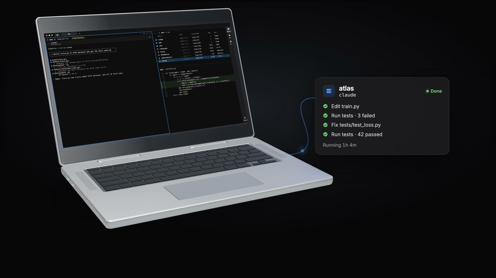
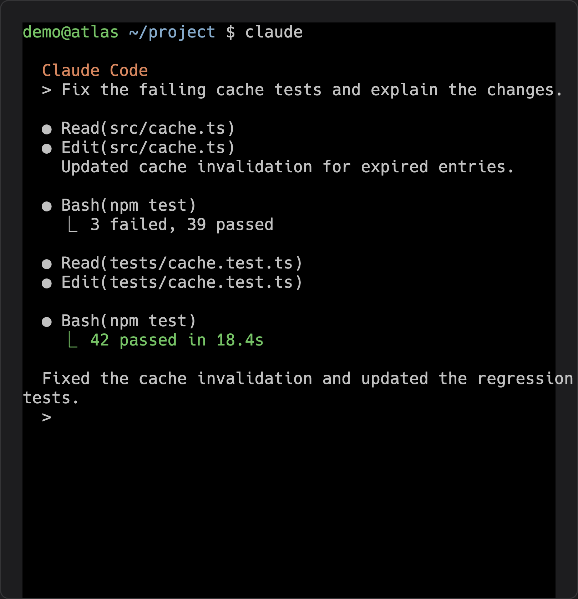
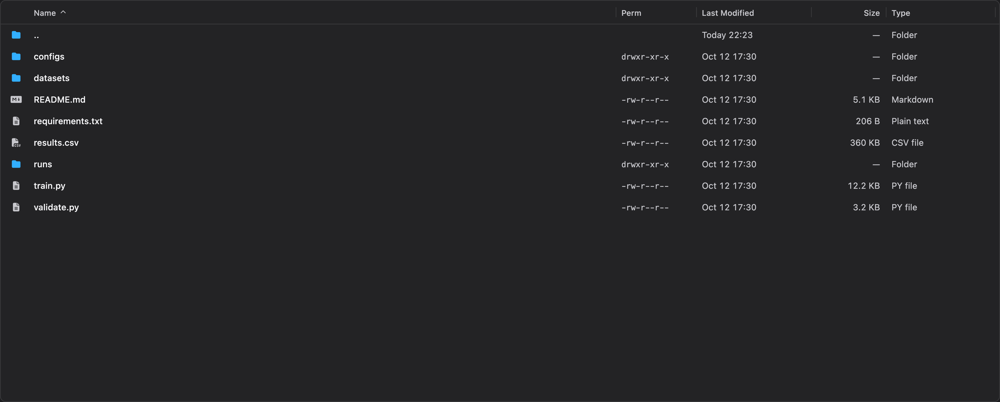
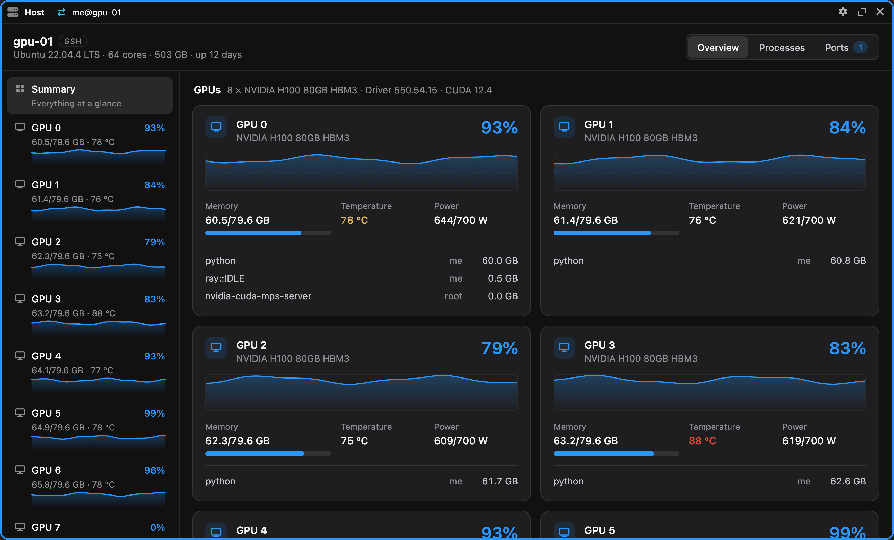
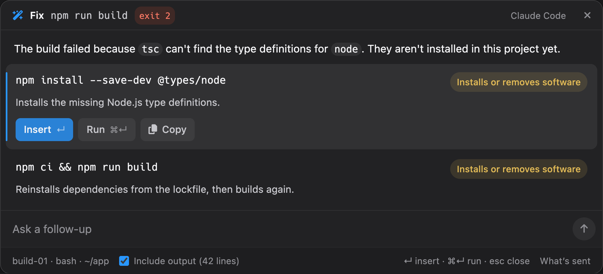

  
  <h1>GenieTerm</h1>
  
An open-source terminal for working across machines.

  

    <a href="https://ry3ng.github.io/GenieTerm/"><strong>Explore the product</strong></a> ·
    <a href="https://github.com/Ry3nG/GenieTerm/releases/latest"><strong>Download</strong></a> ·
    <a href="./CONTRIBUTING.md"><strong>Contribute</strong></a> ·
    <a href="./ROADMAP.md">Roadmap</a>
  

  
macOS · Linux · Windows preview &nbsp; / &nbsp; Apache-2.0

<a href="https://ry3ng.github.io/GenieTerm/"><strong>▶ Watch the product film · 1:43</strong></a>

Terminal, remote files, host tools and your own AI, in one workspace.

| In your workspace | What it does                                                          |
| ----------------- | --------------------------------------------------------------------- |
| **Terminal**      | Command blocks and durable SSH sessions for shells and coding agents. |
| **Files**         | Browse, edit and transfer remote files.                               |
| **Host**          | Inspect GPUs, processes and ports. Forward remote services.           |
| **Command AI**    | Write, fix and explain commands with your AI. You decide what runs.   |

No account or telemetry. [How Command AI works](./docs/architecture/command-ai.md).

## Look inside

Product UI, rendered with example data. [Enlarge the interface ↗](https://ry3ng.github.io/GenieTerm/#interface)

<table>
<tr>
<td width="50%"><strong>Terminal / agent session</strong> </td>
<td width="50%"><strong>Files / project browser</strong> </td>
</tr>
<tr>
<td width="50%"><strong>Host / machine overview</strong> </td>
<td width="50%"><strong>Command AI / review a fix</strong> </td>
</tr>
</table>

## Install

[**Latest stable release →**](https://github.com/Ry3nG/GenieTerm/releases/latest)

| Platform              | Install                                                                                | Updates                                                 |
| --------------------- | -------------------------------------------------------------------------------------- | ------------------------------------------------------- |
| **macOS 12+**         | Apple silicon or Intel DMG. Drag GenieTerm into Applications.                          | In the app                                              |
| **Linux x64 / arm64** | Debian / Ubuntu: `.deb`. Other distributions: AppImage. Requires glibc 2.28+.          | AppImage: in the app. `.deb`: download the new package. |
| **Windows x64**       | Unsigned preview builds on [prereleases](https://github.com/Ry3nG/GenieTerm/releases). | Manual                                                  |

**First launch on macOS:** the app is not notarized. After the first launch attempt, use **System Settings → Privacy & Security → Open Anyway**.

**Linux:** install the downloaded package with `sudo apt install ./GenieTerm-linux-*.deb`, or make an AppImage executable with `chmod +x GenieTerm-linux-*.AppImage`. AppImage requires libfuse2. On Ubuntu 23.10 and later, use the `.deb` to keep Chromium's sandbox enabled.

Connect to an SSH host and install the offered `genie` helper to enable durable sessions, command blocks and Host. The command palette's **Quick Start** walks through the workspace.

## Contribute

[Contributing guide](./CONTRIBUTING.md) · [Issues](https://github.com/Ry3nG/GenieTerm/issues) · [Roadmap](./ROADMAP.md)

## Project

[Architecture](./docs/architecture/README.md) · [Release notes](./docs/releases/) · [Security](./SECURITY.md) · [Code of conduct](./CODE_OF_CONDUCT.md)

The [homepage](./site/) is published through GitHub Pages. The product film is made with [Remotion](./film/). [Reproduce the product renders](./site/README.md).

GenieTerm began as a fork of [Wave Terminal](https://github.com/wavetermdev/waveterm). Licensed under [Apache-2.0](./LICENSE); see [NOTICE](./NOTICE) and [ACKNOWLEDGEMENTS.md](./ACKNOWLEDGEMENTS.md).
