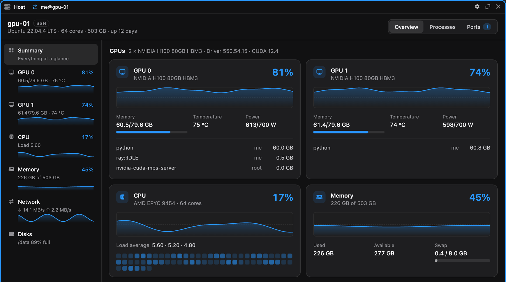

<p align="center">
  
</p>

<h1 align="center">GenieTerm</h1>

<p align="center">The terminal for people who live in SSH.</p>

<p align="center">
  <a href="https://github.com/Ry3nG/GenieTerm/releases/latest"><b>Download</b></a> · macOS · Linux
</p>

<p align="center">
  
</p>

GenieTerm puts your shell, the machine it runs on, and that machine's files in one window.

- **Command blocks.** Each command keeps its output, status and duration together, so you can copy it, run it again, or jump to the previous one. Underneath, it's an ordinary xterm session.
- **Durable SSH.** A session keeps running on the host through sleep, network changes and restarts. When it reattaches, everything it printed while you were away streams back.
- **Remote files.** Browse, preview and edit files on any host, right beside the shell that's using them. Drag files in to upload, or download a whole folder.
- **Host.** See CPU, memory, every NVIDIA GPU and the processes holding it, and the ports in use. Forward a remote port to `localhost` in one click.

There's no account and no telemetry. The one AI feature is optional: describe what you want and GenieTerm proposes a command for you to review. It never runs one on its own.

## Install

**macOS 12 or later** (Apple Silicon or Intel). Open the `.dmg` and drag GenieTerm to Applications. The app isn't notarized yet, so the first time you open it, go to System Settings → Privacy & Security and click **Open Anyway**. After that, GenieTerm keeps itself up to date.

**Linux** (x64 or arm64; glibc 2.28 or later, such as Ubuntu 20.04 or Debian 10):

```sh
sudo apt install ./GenieTerm-linux-x64-*.deb      # Debian, Ubuntu
chmod +x GenieTerm-linux-x64-*.AppImage           # any distribution; needs libfuse2
```

The AppImage updates itself. A `.deb` install tells you when a new version is out. On Ubuntu 23.10 and later, use the `.deb`: it keeps Chromium's sandbox on, which an AppImage can't do there.

**Windows** builds are unsigned previews on [prerelease tags](https://github.com/Ry3nG/GenieTerm/releases).

## The `genie` helper

GenieTerm offers to install a small helper the first time you connect to a host. The helper powers command blocks, durable sessions and the Host view there. In any GenieTerm terminal, it also gives you:

```sh
genie view README.md    # preview a file in a new block
genie edit ~/.zshrc     # open a file in the editor
```

## Contributing

Bug reports and pull requests are welcome. [CONTRIBUTING.md](CONTRIBUTING.md) covers building from source and how the code is organized, [ROADMAP.md](ROADMAP.md) covers what comes next, and [SECURITY.md](SECURITY.md) covers reporting a vulnerability.

## License

[Apache-2.0](LICENSE). GenieTerm began as a fork of [Wave Terminal](https://github.com/wavetermdev/waveterm). See [NOTICE](NOTICE) and [ACKNOWLEDGEMENTS.md](ACKNOWLEDGEMENTS.md).
